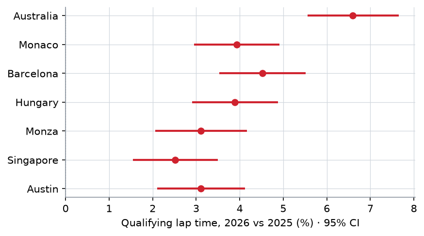
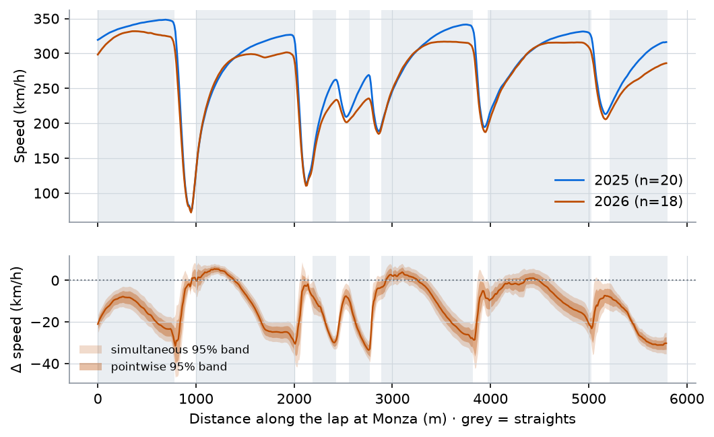
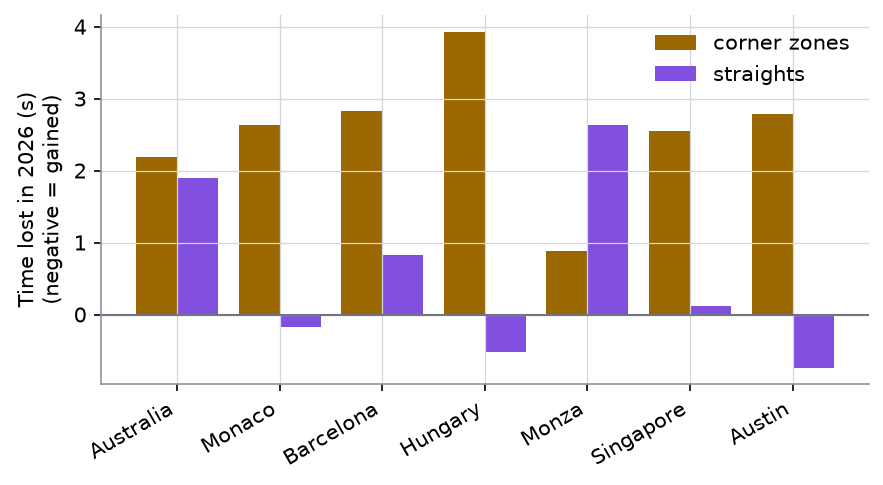
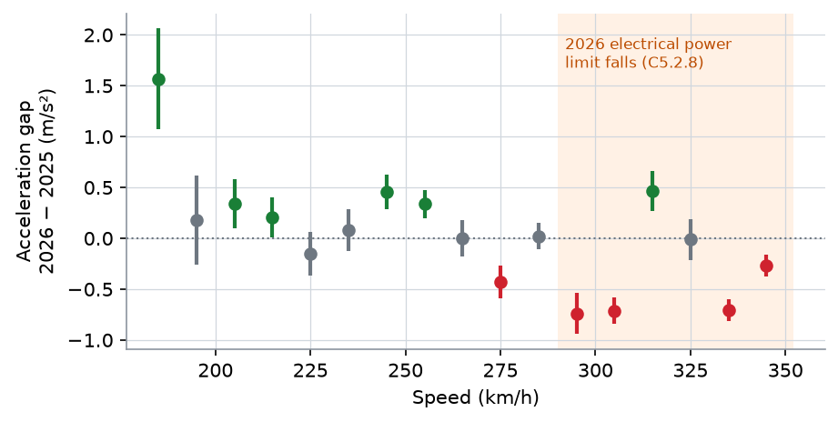
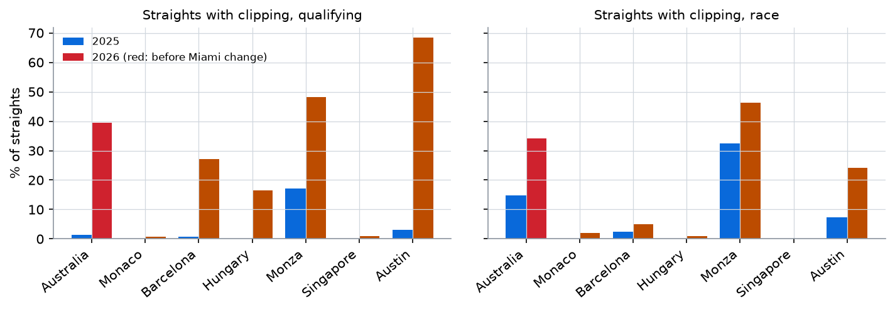
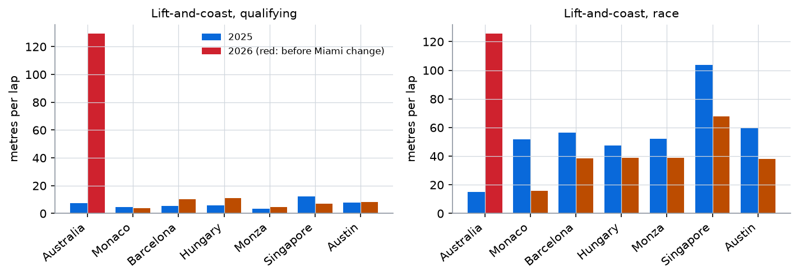
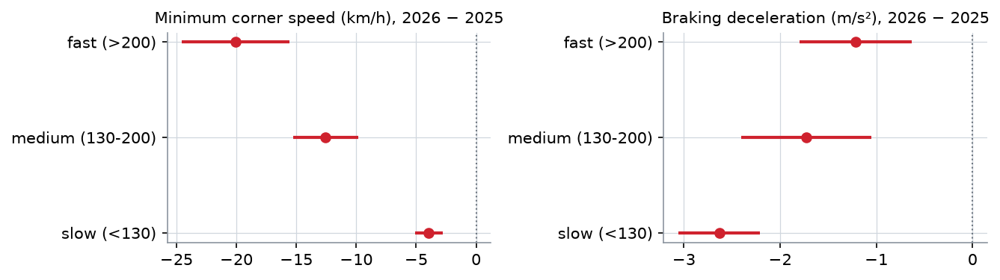

# How the 2026 rules changed Formula 1 cars

**A matched comparison of the 2025 and 2026 cars on seven circuits raced under both rule sets**

Circuits: Australia, Monaco, Barcelona, Hungary, Monza, Singapore, Austin · Sessions: practice 1–3, qualifying, race (no sprints)
Data: TracingInsights telemetry, OpenF1 timing, Pirelli compound choices, FIA Technical Regulations · Analysis date: 29 October 2026

---

## Summary

1. **Qualifying laps were 3.97% slower in 2026** (95% CI 3.03–4.92%, p < 10⁻¹⁶), so pole positions were 1.5–3.4 s slower. The change differs strongly by circuit (likelihood-ratio χ²(6) = 192, p < 10⁻³⁸): from +2.5% at Singapore to **+6.6% at Australia, the only race run before the May 2026 energy-management change**.
2. **Most of the time is lost in corners.** Corner zones cost more time than straights at six of the seven circuits. Monza is the exception, losing 2.6 of its 3.5 s on the straights.
3. **Corners are slower and braking is weaker.** Minimum speed fell by 20.1 km/h in fast corners, 12.5 km/h in medium and 3.9 km/h in slow ones. Braking deceleration fell by 1.2–2.6 m/s² despite the lighter car.
4. **Straights show the new power unit's signature.** Top speed fell by 7.9 km/h on average, and the drop is significant on 39 of 44 straights after Holm correction. Comparing the same circuit at the same speed, 2026 cars **accelerate harder below ~260 km/h**, with 350 kW of electric torque in a lighter car, **and worse above 290 km/h**, where Art. C5.2.8 makes the electrical power limit fall with speed. The pre-specified contrast is −0.57 m/s² (95% CI −0.71 to −0.43).
5. **The cars run out of energy on straights.** The share of qualifying straights where the car slows down at full throttle ("clipping") rose from 3.8% to 29.1% (odds ratio 45, 95% CI 26–79). In races it rose from 6.6% to 16.4% (odds ratio 2.8).
6. **The Miami change worked for lift-and-coast.** Under the original 2026 rules (Australia), drivers coasted an extra 107 m per qualifying lap. After the change it was +1 m (difference-in-differences p = 2×10⁻⁵). Race clipping odds fell from 12× to 2.7× the 2025 level.
7. **Racing lines hardly moved.** In only 6 of 57 corner zones does the 2026 mean line differ from 2025 by more than measurement noise (median offset 0.7 m).
8. **Tyres degrade slightly faster.** The increase is +0.016 s per lap of tyre age (95% CI 0.004–0.028, p = 0.016), and the number of pit stops did not change (rate ratio 1.09, p = 0.32).
9. **No reliable change in the racing.** Neither overtakes (negative binomial rate ratio 1.14, p = 0.28) nor the spread of race pace across the field (paired Wilcoxon p = 0.38) changed reliably.
10. **Power units diverged in 2026.** Honda-powered cars (Aston Martin) were 10.4 km/h slower at top speed than Mercedes-powered cars and clipped more. Ferrari (−3.3 km/h) and Audi (−2.2 km/h) also trailed, and Red Bull Ford matched Mercedes. With one team per Honda and Audi engine, engine and chassis cannot be separated.

The dashboard (`dashboard/app.py`) shows every result interactively, for every circuit.

---

## 1. Question and hypotheses

The 2026 rules changed the car in four ways that should leave traces in public telemetry. Parameter values are quoted from the FIA PDFs (`reference/regulations.csv`):

| Change | 2025 | 2026 | Hypothesis |
|---|---|---|---|
| Electric motor (MGU-K / ERS-K) | 120 kW, no speed limit | 350 kW, but **P ≤ 1800 − 5·v kW**: full power only up to 290 km/h, 100 kW at 340, 0 at 345 (Art. C5.2.8) | **H1** stronger low-speed acceleration; **H2** weaker acceleration above 290 km/h |
| MGU-H and energy | MGU-H recovers exhaust energy without limit | MGU-H removed; recharge ≤ 8.5 MJ/lap (Art. C5.2.10); fuel energy flow ≤ 3000 MJ/h | **H3** cars run out of deployable energy on straights (clipping); **H4** drivers lift and coast to recharge |
| Car | 800 kg, wheelbase ≤ 3600 mm | 724 kg + tyres, wheelbase ≤ 3400 mm | **H5** shorter braking, better slow corners |
| Aero and tyres | DRS; ground-effect floor; C1–C6 tyres | Active front and rear wings (Corner/Straight Mode); narrower tyres (front −25 mm, rear −30 mm); C1–C5 | **H6** less downforce and grip: slower fast and medium corners; **H7** tyre wear changes |

One rule change happened during the season. From the **Miami GP (3 May 2026)**, peak "super-clip" power rose from 250 to 350 kW and the qualifying recharge limit fell from 8 to 7 MJ, explicitly to cut lift-and-coast. Of our circuits, only **Australia (8 March 2026)** ran under the original settings. This gives a third comparison, **H8**: pre- vs post-Miami.

## 2. Data

| | |
|---|---|
| Laps | 39,763 laps in total; 26,189 *clean* |
| Telemetry | 26,455 clean laps resampled; 21,747 passed the quality check (99% of push laps, 90% of race-pace laps) |
| Drivers | 30 in 2025, 31 in 2026 (including practice reserves); 10 teams in 2025, 11 in 2026 (Cadillac new; Sauber became Audi) |
| Sessions | All of FP1–3, qualifying and race, except the sprint weekends Austin 2025 and Singapore 2026, which have FP1 only |

**Sources.** TracingInsights per-lap telemetry and lap tables, 2025 and 2026. The 2025 repository was cloned *sparsely*: only the 35 event/session folders we need (1.2 GB). OpenF1 supplied sessions, overtakes and pit data. Pirelli and F1.com supplied compound nominations (`reference/compounds.csv`). The FIA supplied the 2025 Technical Regulations (issue 3) and the 2026 Section C (issue 21). Team lineage and power-unit supplier come from F1DB (`reference/teams.csv`).

**Lap filters.**
- *Clean:* timed, dry tyres, not deleted, not an in- or out-lap, no safety car, virtual safety car or red flag, and not lap 1 of a race. Only the 2025 Australian race was wet (750 laps on intermediates).
- *Push:* a clean practice or qualifying lap within 102% of that driver's session best.
- *Race pace:* a clean race lap within 107% of that driver's median.

**Telemetry quality check.** While building the dataset I found that the **2026 Hungarian GP race telemetry is mis-sliced**. Laps start mid-lap: lap 30 starts at 137 km/h, where a Hungaroring lap should start at about 285 km/h, and lap distances range from 4,030 to 4,517 m on a 4,381 m track. A few laps elsewhere are broken too: some 2026 Monza qualifying laps "pass" the Roggia chicane at 300 km/h. Each lap's speed trace was therefore cross-correlated (circularly, via FFT) with the median qualifying push lap of its circuit and year. A lap is kept only if:
- its best alignment is within 30 m,
- its correlation at zero shift is ≥ 0.90,
- its telemetry duration matches the official lap time within 0.5 s.

Before this filter, the broken laps had produced a spurious +29 km/h at Monza's Roggia chicane and inflated the racing-line differences (17 zones "beyond noise" instead of 6). Lap-time analyses don't depend on telemetry and use all clean laps.

## 3. From telemetry to features

- **Common distance axis.** Each lap is resampled to a 10 m grid: distance = TracingInsights `rel_distance` × official lap length. Raw telemetry is about 3.7 Hz, one sample every ~22 m at 300 km/h, so 10 m does not invent resolution.
- **One segment map per circuit, shared by both years.**
  - **Straights:** runs where the average of the 2025 and 2026 median qualifying throttle is ≥ 90% for ≥ 200 m. Gaps under 50 m are closed, and the two halves of the start/finish straight are kept if each is ≥ 100 m.
  - **Corner zones:** the rest of the lap, split at the speed peaks between corners (`scipy.signal.find_peaks`, prominence 10 km/h), so each zone holds one braking event.
  - Official corner numbers are attached by matching the FIA corner coordinates to the mean driving line.
  - Result: 44 straights and 57 corner zones.
- **Straight features:** top speed; entry and exit speed; acceleration over the last 30% of the straight; **distance spent slowing down at full throttle** (throttle ≥ 98% and dv/ds < −0.05 km/h per m; ≥ 30 m counts as *clipping*); time taken.
- **Corner features:** minimum speed; braking distance (first brake application to minimum speed); speed at braking; distance back to full throttle; **lift-and-coast** (throttle < 10% with no brake, between the last flat-out point and the brake); lowest gear; time taken.
- **Acceleration:** $a = v\,\frac{dv}{ds}$ from the 50 m-smoothed speed, using samples at full throttle, with no brake, in gear ≥ 5 and above 150 km/h.

## 4. Statistical methods

Throughout, **y26** is the 2026 indicator. **Team-era** is team lineage × year: it absorbs each team's competitiveness *within* each rule set, so a team that got better or worse does not leak into the rule effect. **Driver-era** (driver × year) is the cluster for repeated laps by the same driver. Per-circuit tests are Holm-corrected within each family. All model output is in `results/models/`.

**4.1 One-lap pace.** Data: each driver's best qualifying lap, a linear mixed model fitted by REML (statsmodels `MixedLM`):

$$\log t_{ic} = \alpha_c + \beta_c\,\mathrm{y26}_i + \gamma\,\mathrm{temp}_{ic} + u_{\text{team-era}(i)} + \varepsilon_{ic},\qquad u\sim N(0,\sigma_u^2)$$

- Circuit effects are reported as $100(e^{\beta_c}-1)\%$.
- Heterogeneity is a likelihood-ratio test (ML fits) of circuit-specific $\beta_c$ against a common $\beta$.
- A weighted meta-regression (weights $1/\widehat{se}^2$) asks whether $\beta_c$ grows with the share of the 2025 lap spent at full throttle.

**4.2 Where on the lap: functional comparison.**
- Inputs: the mean speed curves $\bar v_y(s)$ of the best qualifying laps, and the difference $\hat\Delta(s)=\bar v_{2026}(s)-\bar v_{2025}(s)$.
- A **driver bootstrap** (B = 2000, resampling drivers within each year) gives pointwise bands $\hat\Delta(s) \pm 1.96\,\widehat{se}(s)$.
- **Simultaneous 95% bands** $\hat\Delta(s)\pm c^{*}\widehat{se}(s)$ use the studentised maximum
$$c^{*} = q_{0.95}\!\left(\max_s \frac{|\hat\Delta^{*}_b(s)-\hat\Delta(s)|}{\widehat{se}(s)}\right),$$
so "the band excludes zero here" holds for the lap as a whole, not just at one point.
- The same procedure applies to the cumulative time gap $\Delta t(s)$. Its increment over each segment gives the time lost or gained there, with bootstrap percentile CIs.

**4.3 Acceleration vs speed (H1, H2).** Acceleration is averaged per lap and 10 km/h speed bin, then fitted by OLS with **circuit × bin fixed effects**, so years are compared at the same circuit and the same speed:

$$\bar a_{\ell b} = \mu_{c(\ell),b} + \delta_b\,\mathrm{y26}_\ell + \varepsilon_{\ell b},$$

with SEs clustered by driver-era. The pre-specified test of Art. C5.2.8 is the contrast $\theta=\overline{\delta}_{b\ge 290}-\overline{\delta}_{b<290}$.

A first attempt used a piecewise-linear model with a knot at 290 km/h. It gave a misleading answer: its "below 290" slope was driven by the stronger 2026 acceleration at low speed. The binned design separates the two effects, so it replaced the knot model.

**4.4 Straights and clipping (H3).**
- Top speed per straight: Welch tests, Holm-corrected. A weighted regression of the 2026 − 2025 difference on the 2025 top speed checks whether the loss grows with speed.
- Clipping, a **hurdle model**:
  - occurrence (≥ 30 m of slowing while flat out): logistic GEE, exchangeable correlation within driver-era;
  - distance, given that it occurs: gamma GEE with log link.
  - Both use `circuit + y26 × session type + log(straight length)`.

**4.5 Lift-and-coast and the Miami change (H4, H8).**
- Data: one value per driver, circuit and session type (mean metres per lap).
- OLS with circuit × session fixed effects and separate 2026 terms *before* (Australia) and *after* Miami, with SEs clustered by team-era.
- The difference-in-differences $\theta_{\mathrm{DiD}}=\beta_{\text{pre}}-\beta_{\text{post}}$ asks whether the 2026 effect was larger under the original settings. The clipping occurrence model was refitted the same way.

**4.6 Corners (H5, H6).**
- Data: one value per driver and corner zone, from qualifying push laps.
- OLS with corner fixed effects and one 2026 effect per speed class: slow < 130, medium 130–200, fast > 200 km/h, using the 2025 median minimum speed. SEs are clustered by team-era.
- Braking deceleration is $(v_{\text{brake}}^2-v_{\min}^2)/(2\,d_{\text{brake}})$, for corners with ≥ 20 m of braking.
- *Note:* the lap-level mixed models for corners and lift-and-coast had non-positive-definite Hessians (NaN or exploding SEs). The aggregated cluster-robust models replace them. Their estimates agree with the raw per-corner differences (fast −19.2, medium −12.0, slow −2.9 km/h).

**4.7 Racing lines.** The offset is the distance from each point of the 2026 mean line to the nearest point of the 2025 mean line. As a **noise floor**, the same offset is computed between two random halves of the 2025 laps (50 splits). A zone counts as changed when its mean offset exceeds the 95th percentile of that noise.

**4.8 Tyres (H7).**
- Per circuit-year, a mixed model on race-pace laps: lap time ~ compound + compound × tyre age + lap number + (1 | driver). The lap-number term absorbs fuel burn, and multiple stints per driver separate it from tyre age.
- The degradation slopes are pooled by weighted least squares with circuit and compound adjusted.
- Pit stops per finisher: Poisson GLM with circuit fixed effects.

**4.9 Racing.**
- Overtakes per race (OpenF1): Poisson GLM with circuit fixed effects. Its Pearson dispersion was **11**, so inference uses a negative binomial model and a paired Wilcoxon test over the seven circuits.
- Field spread: the SD of each driver's median race lap relative to the fastest, compared by paired Wilcoxon, plus Brown–Forsythe tests per circuit.

**4.10 Power units.** Per year, OLS of each straight feature on straight fixed effects plus power unit (reference: Mercedes), with SEs clustered by driver-era.

## 5. Results

### 5.1 Lap time (H6 overall)



| Circuit | Change (95% CI) | Pole 2025 → 2026 | Δ pole |
|---|---|---|---|
| Australia *(pre-Miami)* | **+6.60%** (5.55, 7.65) | 75.096 → 78.518 s | +3.42 s |
| Barcelona | +4.52% (3.53, 5.51) | 71.546 → 74.679 s | +3.13 s |
| Monaco | +3.93% (2.95, 4.92) | 69.954 → 72.051 s | +2.10 s |
| Hungary | +3.89% (2.91, 4.88) | 74.890 → 77.207 s | +2.32 s |
| Monza | +3.11% (2.06, 4.16) | 78.792 → 81.786 s | +2.99 s |
| Austin | +3.11% (2.10, 4.12) | 92.510 → 94.035 s | +1.53 s |
| Singapore | +2.51% (1.54, 3.49) | 89.158 → 91.373 s | +2.22 s |
| **Pooled** | **+3.97% (3.03, 4.92)** | | |

All seven effects are significant after Holm correction, and they differ from each other (LR χ²(6) = 192.3). The difference is **not** explained by how power-sensitive the circuit is: the meta-regression slope on the 2025 full-throttle share is +0.04 percentage points of lap time per percentage point, p = 0.50, with n = 7. Australia's large penalty fits the original energy rules (§5.4). It also coincides with the first race of a brand-new car generation, so the two explanations cannot be separated.

### 5.2 Where the time goes



At Monza the 2025 cars keep accelerating towards 330–345 km/h on every straight, while **the 2026 cars plateau 15–30 km/h lower (about 300–330 km/h) and in places slow down with the throttle still wide open**. On the main straight, for example, they peak at ~332 km/h and drop to ~325 km/h before braking for turn 1. The simultaneous band excludes zero over most of every straight. In Monaco (`report/figures/fig2_speed_monaco.png`) the differences sit in the corners instead.



| Circuit | Corners (s) | Straights (s) | Total (s) |
|---|---|---|---|
| Australia | +2.19 | +1.90 | +4.09 |
| Monaco | +2.63 | −0.18 | +2.45 |
| Barcelona | +2.82 | +0.83 | +3.65 |
| Hungary | +3.93 | −0.52 | +3.41 |
| Monza | +0.88 | +2.63 | +3.51 |
| Singapore | +2.55 | +0.12 | +2.67 |
| Austin | +2.79 | −0.74 | +2.05 |

*(Mean best qualifying lap per year; totals are mean differences, not pole differences.)*

At Monaco, Hungary and Austin the 2026 cars actually **gain** time on the straights. Those straights are short and fed by slow corners, where the stronger low-speed acceleration (§5.3) outweighs the lower top speed.

### 5.3 Power unit signature on straights (H1, H2)



- **Top speed:** −7.9 km/h on average, significant on 39 of 44 straights (Holm). The loss does **not** grow with the 2025 top speed (slope −0.05 km/h per km/h, p = 0.50): lower top speed is broad and not limited to the fastest straights.
- **Low speed (H1 supported):** within circuit and speed, 2026 cars accelerate harder at low speed, +0.38 m/s² on average over 185–245 km/h. This is consistent with 350 kW of electric torque in a lighter car.
- **High speed (H2 supported):** above 290 km/h the 2026 gap is clearly negative: −0.71 m/s² at 290–300 km/h, −0.74 at 300–310, −0.71 at 330–340. The contrast with the bins below 290 is **−0.57 m/s² (95% CI −0.71, −0.43; p = 10⁻¹⁵)**, as Art. C5.2.8 predicts. One bin (310–320 km/h, +0.45) goes the other way; few circuits reach it in both years, so its estimate rests on fewer data.

### 5.4 Energy limits: clipping and lift-and-coast (H3, H4, H8)



| Clipping, 2026 vs 2025 | Qualifying | Race |
|---|---|---|
| Share of straights | 3.8% → 29.1% | 6.6% → 16.4% |
| Odds ratio (GEE) | **45.4** (26.1, 79.1) | **2.81** (2.01, 3.95) |
| Distance when it happens | ×2.74 (2.40, 3.13) | ×1.14 (1.05, 1.24) |
| Odds ratio pre-Miami (Australia) | 52.6 (23.4, 118.1) | **12.0** (6.3, 22.7) |
| Odds ratio post-Miami | 55.1 (32.1, 94.7) | **2.67** (1.90, 3.75) |
| Ratio pre / post | 0.95, p = 0.89 | **4.50** (2.40, 8.43), p = 3×10⁻⁶ |



| Extra lift-and-coast vs 2025 (m/lap) | Pre-Miami (Australia) | Post-Miami (6 circuits) | Difference-in-differences |
|---|---|---|---|
| Qualifying | **+106.9** (56.5, 157.2) | +1.2 (−3.3, 5.8) | +105.6, p = 2×10⁻⁵ |
| Race | **+102.5** (70.0, 135.0) | −22.0 (−45.5, 1.4) | +124.5, p = 1×10⁻⁹ |

The data match the stated aim of the Miami change:
- Under the original settings, drivers coasted more than 100 m per lap *even in qualifying*. After the change, qualifying lift-and-coast is back at 2025 levels, and race lift-and-coast falls slightly below 2025.
- Qualifying clipping did **not** fall. Raising super-clip power to 350 kW moved energy recovery from coasting to harvesting at full throttle, which is exactly what our clipping measure detects.
- Race clipping fell by a factor of 4.5.

### 5.5 Corners and braking (H5, H6)



| 2026 − 2025 | Slow (< 130 km/h) | Medium (130–200) | Fast (> 200) |
|---|---|---|---|
| Minimum speed (km/h) | −3.9 (−5.1, −2.8) | −12.5 (−15.2, −9.8) | **−20.1** (−24.5, −15.6) |
| Braking deceleration (m/s²) | **−2.63** (−3.06, −2.21) | −1.73 (−2.41, −1.05) | −1.21 (−1.80, −0.63) |

- **H6 is clearly supported:** the faster the corner, the bigger the loss, the pattern of an aerodynamic-downforce deficit.
- **H5 is not supported:** the lighter, shorter 2026 cars do *not* brake harder. Deceleration is lower in every class, most of all in slow corners, where braking is limited by tyre grip. That fits the narrower tyres. Part of the braking difference may also come from the much stronger 350 kW regenerative braking changing how the brakes are used. Public telemetry only has a binary brake signal, so the two cannot be separated.
- **Racing lines** moved little: 6 of 57 corner zones exceed the split-half noise floor, and the median offset is 0.7 m.

### 5.6 Tyres and race (H7)

- **Degradation:** +0.016 s per lap of tyre age (95% CI 0.004–0.028, p = 0.016). That's about +0.4 s at the end of a 25-lap stint. The tyre choices also changed at Barcelona (C2–C4 instead of C1–C3) and Austin (C2–C4 instead of C1/C3/C4), and Monaco lost the C6. Compound choice and tyre construction can't be fully separated with seven circuits.
- **Pit stops:** no change (Poisson rate ratio 1.09, 95% CI 0.92–1.30).
- **Overtakes:** the naive Poisson model suggests +16% (p < 0.001), but the data are overdispersed (Pearson χ²/df = 11). The negative binomial gives a rate ratio of 1.14 (0.90, 1.43), p = 0.28, and the paired Wilcoxon p = 0.39: **no reliable change**.
- **Field spread:** +0.31 percentage points in the SD of the gap to the fastest driver (Wilcoxon p = 0.38). Only Austin shows a significant variance change (Brown–Forsythe, Holm p = 0.008).

### 5.7 Power units

Top speed relative to Mercedes-powered cars in 2026, qualifying push laps, straight fixed effects:

| Power unit | Teams | Δ top speed (km/h) | Δ slowing at full throttle (m per straight) |
|---|---|---|---|
| Red Bull Ford | Red Bull, Racing Bulls | +0.2 (−1.0, 1.3) | +2.2 (−2.6, 7.0) |
| Audi | Audi | −2.2 (−3.3, −1.1) | +3.4 (−1.7, 8.5) |
| Ferrari | Ferrari, Haas, Cadillac | −3.3 (−4.3, −2.3) | +0.3 (−5.1, 5.7) |
| Honda | Aston Martin | **−10.4** (−11.4, −9.5) | **+8.0** (3.3, 12.7) |

In 2025 the power units were within ±1.1 km/h of each other. The 2026 rules spread them out, but top speed also depends on each car's drag. That makes the Honda and Audi effects engine-plus-car effects.

## 6. Threats to validity

1. **Only seven circuits.** Per-circuit effects are precise, but circuit-level explanations (the meta-regressions) have very little power. Their slopes are descriptive.
2. **Era vs maturity.** The 2025 cars were the last of a mature formula. The 2026 cars were new and improved through the season, so part of the "rule effect" is development. In particular, the pre-Miami regime is observed at one circuit, Australia, which was also the first race of 2026. Regime, circuit and development stage are confounded there.
3. **Teams and drivers changed.** Team-era random effects and clustering absorb the competitive order of each era, but not driver changes within a team.
4. **Conditions.** Track temperature is adjusted in the pace model; track evolution, wind and possible resurfacing are not.
5. **Telemetry limits.** About 3.7 Hz sampling; distance from interpolation; acceleration derived, not measured. Battery state, deployment and active-aero mode are not in public telemetry. The meaning of TracingInsights' `drs` field in 2026 (there is no DRS) is unclear, so it was not used. 18% of resampled laps failed the quality check, mostly non-push laps and the 2026 Hungarian race.
6. **Definitions.** The clipping (≥ 30 m, −0.05 km/h/m) and lift-and-coast (< 10% throttle, no brake) thresholds are reasonable but not validated. A sensitivity analysis over these thresholds is the obvious next check.
7. **Multiplicity.** Holm correction applies within families, not across the whole study. The many families make this an exploratory analysis with confirmatory-quality estimates for the main effects.
8. **Overtakes** come from OpenF1's position-change detection, which may count some position changes caused by pit stops.

## 7. Next steps

- **Sensitivity analysis:** clipping and coasting thresholds, segment definition, quality-check cut-offs.
- **Bayesian hierarchical model** (circuits as random effects, partial pooling across circuits and corners) to estimate the circuit heterogeneity better.
- **Within-2026 development:** model the trend across the 2026 rounds (all circuits, not only the matched seven) to separate learning from the rules.
- **Neural networks** (the planned next phase):
  - an era classifier on speed/throttle/brake traces with integrated-gradients attribution, to map *where* each lap "looks 2026";
  - an autoencoder trained on 2025 segments, to flag the most changed parts of each lap.

## 8. Reproduce

```bash
cd regs_analyzer_25_26
py -3.11 -m venv .venv
.venv\Scripts\python -m pip install -r requirements.txt
.venv\Scripts\python -m pipeline.fetch        # sparse TracingInsights 2025 clone + OpenF1 meetings (reuses ../TracingInsights_2026 if present)
.venv\Scripts\python -m pipeline.build_laps   # matched lap table
.venv\Scripts\python -m pipeline.features     # 10 m grids, quality check, segments, features (--reuse skips resampling)
.venv\Scripts\python -m pipeline.stats        # all models -> results/
.venv\Scripts\python report\make_figures.py   # figures for this report
.venv\Scripts\python dashboard\app.py         # http://127.0.0.1:8050
```

Sources for every compound choice and rule change are in `reference/`. Model output is in `results/models/`.
